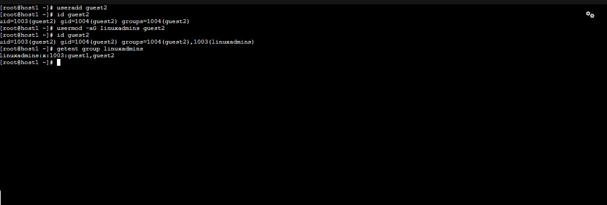
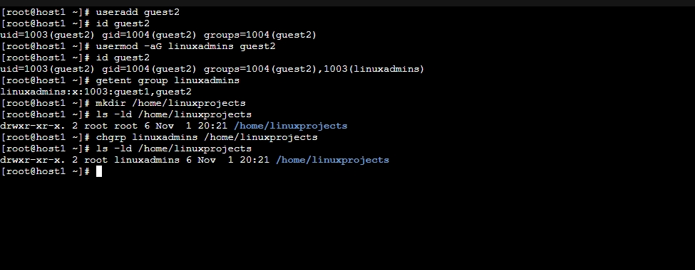
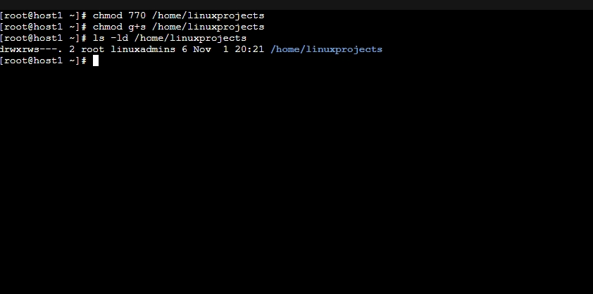
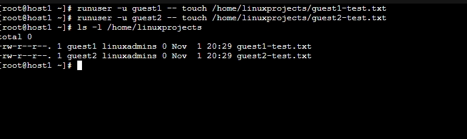
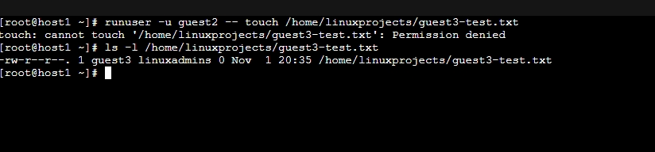
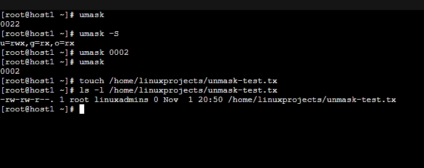

# Project 01: Linux Identity & Access Management

## Project Overview

This project documents hands-on Linux administration exercises completed using Red Hat Enterprise Linux browser-based training labs.

The objective was to develop practical skills in managing Linux users, groups, file ownership, permissions, and access controls.

**Environment:** Red Hat Enterprise Linux (RHEL) training labs  
**Training:** RHCSA preparation  
**Status:** Guided exercises completed; independent validation ongoing  
**Date:** November 1, 2026

## 1. User and Group Administration

Practiced creating Linux users and groups.

```bash
useradd guest1
groupadd linuxadmins
usermod -aG linuxadmins guest1
```

Verified user and group membership:

```bash
id guest1
getent group linuxadmins
```

### Skills Demonstrated
- Creating local Linux users
- Creating groups
- Managing supplementary group membership
- Verifying user identities and group assignments

## 2. File Ownership Management

Practiced changing file ownership and group ownership.

```bash
chown guest1:linuxadmins /root/project.txt
chgrp linuxadmins /home/linuxprojects
```

Verified ownership using:

```bash
ls -l /root/project.txt
```

## 3. Linux File Permissions

Practiced configuring file permissions using numeric notation.

```bash
chmod 640 /root/project.txt
chmod 750 /root/project.txt
```

Permission examples:

| Mode | Owner | Group | Others |
|---|---|---|---|
| 640 | Read/Write | Read | None |
| 750 | Read/Write/Execute | Read/Execute | None |
| 770 | Full Access | Full Access | None |

## 4. Shared Directory Configuration

Created a shared directory for authorized group members.

```bash
mkdir /home/linuxprojects
chgrp linuxadmins /home/linuxprojects
chmod g+w /home/linuxprojects
chmod o-rx /home/linuxprojects
chmod g+s /home/linuxprojects
```

The setgid permission was configured so newly created files inherit the directory's group ownership.

Verified directory permissions using:

```bash
ls -ld /home/linuxprojects
```

Expected configuration:

```text
drwxrws--- root linuxadmins
```

## 5. Access Control Testing

Tested access restrictions using separate Linux accounts.

```bash
useradd guest4
id guest4
runuser -u guest4 -- touch /home/linuxprojects/guest4test.txt
```

The test returned:

```text
Permission denied
```

This demonstrated that the unauthorized user could not create files inside the restricted directory.

## 6. Permission-Based File Searches

Practiced identifying files based on their permission settings.

```bash
find /root -type f -perm 640
```

The search successfully identified:

```text
/root/project.txt
```

Also studied identifying world-writable files:

```bash
find /root -type f -perm -002
```

## 7. Troubleshooting

During the exercises, several issues were encountered and resolved.

| Issue | Resolution |
|---|---|
| Invalid group | Created the required group using `groupadd` |
| Directory not found | Created the directory using `mkdir` |
| Incorrect ownership command | Corrected `chown` syntax |
| Incorrect file path | Verified the filename and directory |
| Incorrect `find` syntax | Added the required space between command and path |

These exercises reinforced the importance of interpreting Linux error messages and verifying configurations.

## 8. Security Relevance

This project introduced several security principles:

- Principle of least privilege
- User and group-based access control
- File ownership and permission management
- Restricting unauthorized access
- Shared directory security
- Identifying potentially insecure file permissions

These concepts provide a foundation for future studies involving SELinux, DISA STIGs, and NIST SP 800-171.

## 9. Lessons Learned

Key takeaways:

1. File ownership and file permissions serve different purposes.
2. Supplementary group membership can provide access to shared resources.
3. Setgid enables group ownership inheritance in shared directories.
4. File permissions must be evaluated alongside parent directory permissions.
5. Linux error messages are useful troubleshooting tools.

## 10. Next Steps

- Reinforce numeric and symbolic permissions
- Practice independently configuring user access
- Study default permissions and umask
- Learn Linux Access Control Lists (ACLs)
- Continue RHCSA system administration training
- Recreate this project in an independently configured RHEL environment

---

**Documentation Note:** This project records guided exercises performed in temporary Red Hat training environments. It does not represent a production deployment, RHCSA certification, or a completed compliance assessment.

---

# Lab Evidence & Technical Validation

## Evidence Overview

The following screenshots document hands-on Linux administration exercises performed in temporary Red Hat Enterprise Linux training environments.

The exercises covered identity management, group-based authorization, file ownership, permission management, setgid inheritance, access-control testing, and default file permissions.

Each screenshot provides supporting evidence for a specific configuration or validation activity.

### Evidence 01: Supplementary Group Membership


**Figure 1:** Configured supplementary group membership for `guest1` using `usermod` and verified the resulting primary and supplementary groups with `id`.

**Technical validation:** Confirmed that `guest1` retained its primary group while gaining membership in `linuxadmins`.

### Evidence 02: User Creation and Group Assignment



**Figure 2:** Created a second Linux user, assigned supplementary group membership, and verified the configuration using `id` and `getent`.

**Technical validation:** Confirmed that `guest1` and `guest2` belonged to the `linuxadmins` group.

### Evidence 03: Shared Directory Group Ownership



**Figure 3:** Created `/home/linuxprojects`, assigned group ownership to `linuxadmins` using `chgrp`, and inspected the resulting configuration with `ls -ld`.

**Technical validation:** Confirmed that the directory was owned by `root` with `linuxadmins` as its group.

### Evidence 04: Directory Permissions and setgid



**Figure 4:** Configured directory permissions using `chmod 770` and enabled setgid using `chmod g+s`.

**Verified configuration:**

```text
drwxrws--- root linuxadmins
```

**Security outcome:** Restricted directory access to its owner and authorized group members while enabling group inheritance for newly created files and subdirectories.

### Evidence 05: Authorized User Access



**Figure 5:** Validated that `guest1` and `guest2` could create files inside the shared directory.

**Technical validation:** Confirmed that newly created files retained their respective user owners while inheriting the `linuxadmins` group.

**Security relevance:** Demonstrates authorized access and setgid group inheritance.

### Evidence 06: Unauthorized Access Denied


**Figure 6:** Created an unauthorized user, `guest3`, and attempted to create a file inside the restricted directory.

**Observed result:**

```text
Permission denied
```

**Security outcome:** Confirmed that users outside the authorized group could not create files inside the protected directory.

### Evidence 07: Access Granted Through Group Membership


**Figure 7:** Added `guest3` to `linuxadmins` and repeated the previously denied operation.

**Technical validation:** File creation succeeded after group membership was updated.

**Security outcome:** Demonstrated that access could be granted by modifying group membership without weakening the directory's existing permissions.

### Evidence 08: Existing File Modification Restricted



**Figure 8:** Attempted to update an existing file owned by `guest3` while operating as `guest2`.

**Observed result:**

```text
Permission denied
```

**Technical validation:** Demonstrated that shared group membership and directory write access do not automatically permit modification of another user's existing file.

**Note:** This test used `touch` to attempt a timestamp update. It did not test modification of file contents.

### Evidence 09: Default File Permissions Using umask



**Figure 9:** Inspected the root shell's initial `umask`, changed it from `0022` to `0002`, and created a test file.

**Initial configuration:**

```text
umask 0022
```

**Updated configuration:**

```text
umask 0002
```

**Verified new file permissions:**

```text
-rw-rw-r-- root linuxadmins
```

**Technical validation:** Confirmed that the updated mask permitted group-write access on a newly created regular file.

**Security relevance:** Demonstrates how default permission settings influence access controls in shared Linux environments.

---

## Security Validation Summary

| Security Test | Expected Behavior | Observed Result |
|---|---|---|
| Authorized user creates a file | Allowed | PASS |
| Unauthorized user creates a file | Denied | PASS |
| New files inherit the shared directory group | Inherit `linuxadmins` | PASS |
| Group membership grants authorized access | Allowed after membership change | PASS |
| Group member updates another user's non-group-writable file | Denied | PASS |
| Changing root shell umask affects newly created file permissions | New file receives group-write permission | PASS |
| Group member modifies another user's group-writable file contents | Modification succeeds | NOT YET TESTED |

## Technical Limitations

These exercises were completed in temporary, browser-based Red Hat training environments.

The documented configurations were not deployed to production infrastructure.

The initial exercises involved guided training and assisted troubleshooting. Independent implementation and validation remain areas for continued development.

The cross-user file-content modification test remains incomplete and will be performed during a future lab.

These demonstrations establish foundational Linux administration skills but do not constitute a formal security assessment or evidence of organizational compliance with NIST SP 800-171, CMMC, or DISA STIG requirements.

## Planned Improvements

1. Independently recreate the environment on a personal RHEL virtual machine.
2. Test file-content modification across authorized group members.
3. Investigate default permissions and umask behavior for individual users.
4. Evaluate Access Control Lists (ACLs) for more granular authorization.
5. Add complete environment details and reproducible configuration instructions.
6. Extend the project with applicable Linux security hardening exercises.
